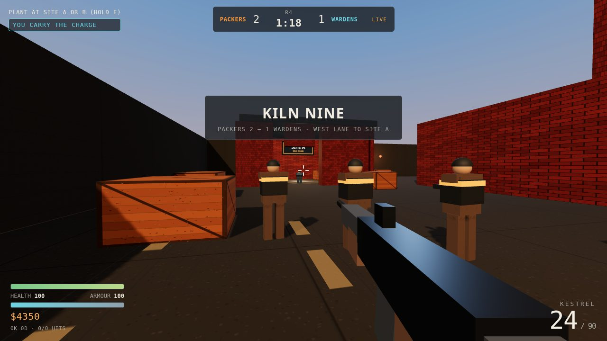

# CINDER YARD

A round-based tactical first-person shooter in the browser, built on three.js 0.187.0 with plain
ES modules and no build step. Two crews fight over a brick kiln works: the PACKERS carry a cinder
charge to one of two sites, the WARDENS hold them and defuse it. First to five rounds takes the yard.



[](https://make.fun/bounty/threejs-fps-01)
[](LICENSE)

## Play it

```bash
node serve.ts          # serves game/ on http://localhost:8080
```

Open the page, pick PACKERS or WARDENS, click to play. Mouse look needs pointer lock: the click on
the play button is the gesture that requests it.

| Input | Action |
| --- | --- |
| W A S D | move (acceleration and friction) |
| Mouse | look |
| Left mouse | fire |
| R | reload |
| Ctrl / C | crouch |
| Shift | walk (quiet and accurate) |
| Space | jump |
| B | buy menu in the buy phase |
| E (hold) | plant the charge as a Packer, defuse it as a Warden |
| G | throw the PITCH frag |
| M | mute |
| Esc | release the mouse |

## What is in the game

- **Rounds.** 12 s buy phase, 100 s live round, 6 s result, first to five. Rounds end by
  detonation, defuse, elimination, or the clock.
- **Gunplay.** KESTREL rifle, TAPPER SMG, MARROW shotgun and SPARK pistol, each with its own
  magazine, reserve, rate and cone. Spread grows with movement and shrinks when crouched, recoil
  kicks and recovers, headshots kill, armour soaks half a hit, and a magazine that runs dry has to
  be reloaded from the reserve.
- **Economy.** $800 to start; $300 a kill, $300 a plant, $3250 a round win, $1400 a loss rising to
  $3400. Six items in the buy menu, one grenade per round.
- **Tactics.** A cinder charge with a 40 s fuse, a 10 s defuse that resets on release or
  interruption, two sites, and bots that route over a nav graph with A*, hold angles, hear gunfire
  and explosions, take cover to reload, and clear a site before they start defusing.
- **Map.** KILN NINE: 48 x 40 m, two approach lanes around a solid kiln block, a north corridor for
  rotates, a roofed brick site with two doors and a cistern yard with two mouths.
- **Look.** Canvas-painted materials, a gradient dusk sky that never renders black, a warm low sun
  with shadows, practical lamps, lane markings, site decals, stencilled signs, a first-person rifle
  with muzzle flash, tracers, impacts, blood and explosions.

## Repository layout

```
game/                 the game: index.html, src/ (simulation and renderer), vendor/three/
screenshots/          four captures of the running game (first by name is the cover)
tests/logic.test.mjs  headless simulation tests (node --test)
tests/browser.py      end-to-end browser tests (Playwright + Firefox under Xvfb)
tools/capture.py      captures the screenshots from a running instance
tools/imagecheck.py   decodes each screenshot and checks the size and brightness limits
main.ts               the entrypoint: copies game/ and screenshots/, writes dossier.json
serve.ts              a local static server for game/
game/DESIGN.json      controls, systems and file map, for the dossier
```

## Test

Headless simulation tests — collision, nav edges and A*, hit detection and headshots, ammo and
reload, bomb plant and defuse timers, round transitions, bot counts and bot behaviour, simulation
cost:

```bash
node --test tests/*.test.mjs
```

End-to-end in a real browser. Headless Firefox does not composite WebGL into screenshots on this
host, so the run is headed Firefox under Xvfb:

```bash
node serve.ts --port 8099 &
xvfb-run -a python3 tests/browser.py
```

It buys a weapon, reaches the live phase, fires and consumes ammo, reloads, plants and detonates to
win, defuses to win, watches the next round start, checks the start screen, and asserts zero page
errors.

Screenshots and their mechanical audit:

```bash
xvfb-run -a python3 tools/capture.py --base http://127.0.0.1:8099 --out screenshots
/usr/bin/python3 tools/imagecheck.py --dir screenshots
```

Build the dossier twice and compare bytes:

```bash
mkdir -p out1 out2
MAKEFUN_OUTPUT_DIR=out1 node main.ts
MAKEFUN_OUTPUT_DIR=out2 node main.ts
sha256sum out1/dossier.json out2/dossier.json
```

## Design notes

- **One job per module.** `sim.js` is the only module that knows about the player and the bots at
  once; `match.js` owns the clock, the score and the bomb; `nav.js` owns the graph; `bot.js` owns
  the brains; the renderer under `render/` only poses what the simulation says.
- **Fixed step, separate render.** 60 Hz simulation with an accumulator, at most five steps per
  frame; the renderer draws once per animation frame from state.
- **No per-frame allocation in the hot paths.** Rays write into a shared result object, the nav
  search reuses stamped scratch arrays, and effects live in fixed pools.
- **The capture path is the game's own path.** Captures stage a live state and call the same
  `consumeState()` / `renderer.render()` the loop calls; nothing is composited.

## Honest limitations

- **This build could not be anchored.** `makefun init` needs
  `GET https://make.fun/api/competitions/threejs-fps-01/requirements`, which answers HTTP 404:
  the site has no `threejs-fps-01` (the live FPS contest is `threejs-fps-02`, deadline
  2026-11-16T21:30Z, already passed when this session started). The repository therefore has no
  `.makefun/freshness.json` anchor and cannot be submitted as a source bundle until the
  competition exists again.
- **Screenshots were audited mechanically, not visually.** The session's vision tool returns
  `401 USER_INACTIVE`, so every capture was checked by decoding the JPEG and measuring dimensions,
  byte size, mean luminance, luminance spread and the near-black fraction, plus a DOM/HUD assertion
  taken at the shutter and a 3x3 ray probe of what is in frame. Nobody has looked at the pictures
  and said they are attractive.
- **Bots are competent, not clever.** They use one route per role, hold fixed angles and only
  investigate noise close enough to matter; they do not coordinate a rush, trade utility, or fake.
- **No network, no assets.** Every texture, sound and mesh is generated in code; there is no audio
  file decode path beyond the synthesiser.
- **Firefox on this host is software-rendered.** Frames are correct but slow; the game targets a
  desktop GPU at 60 fps.
